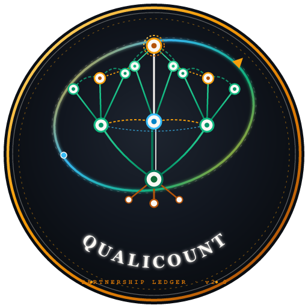
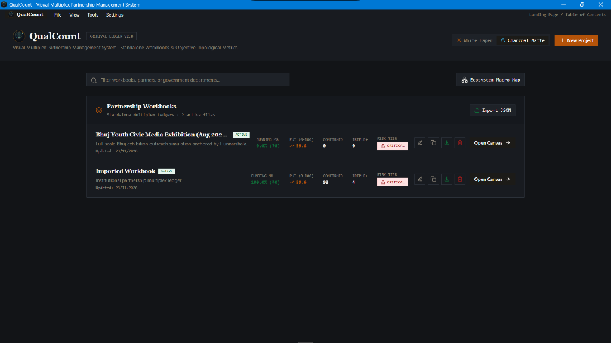
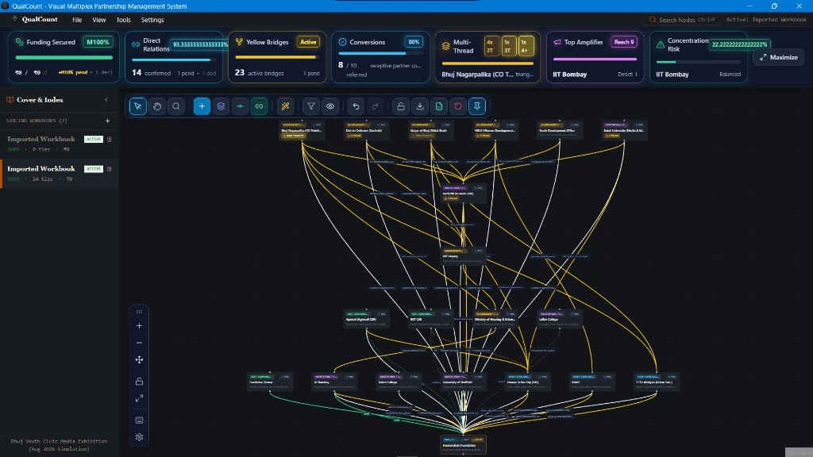
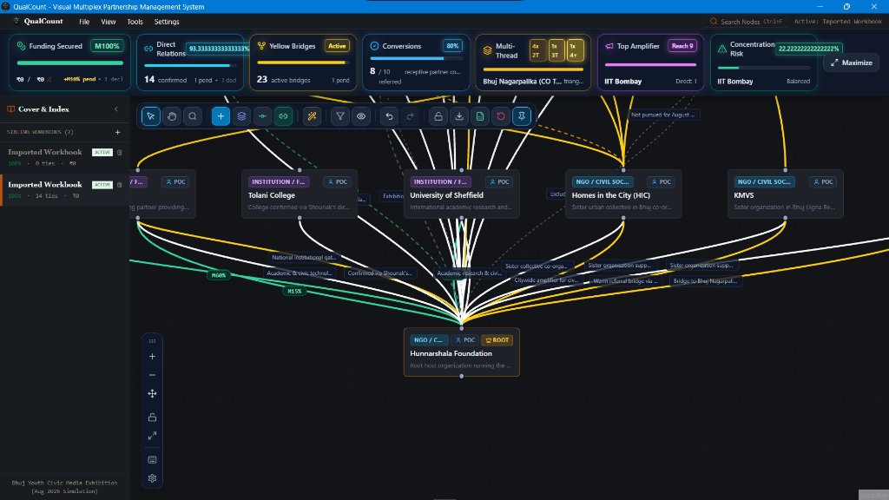
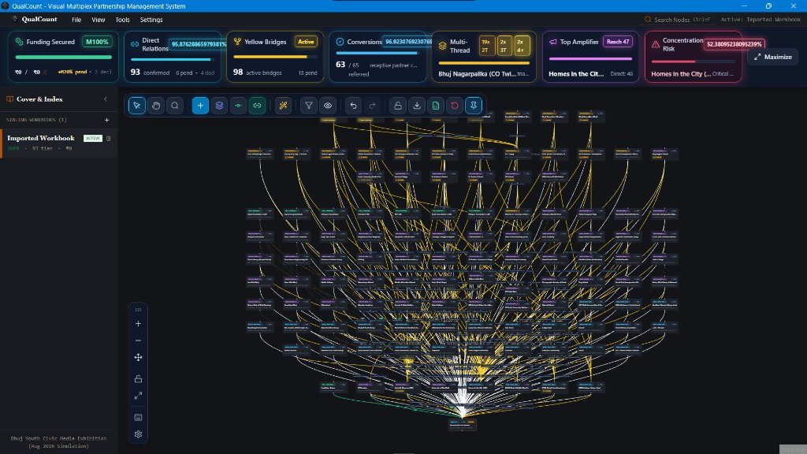
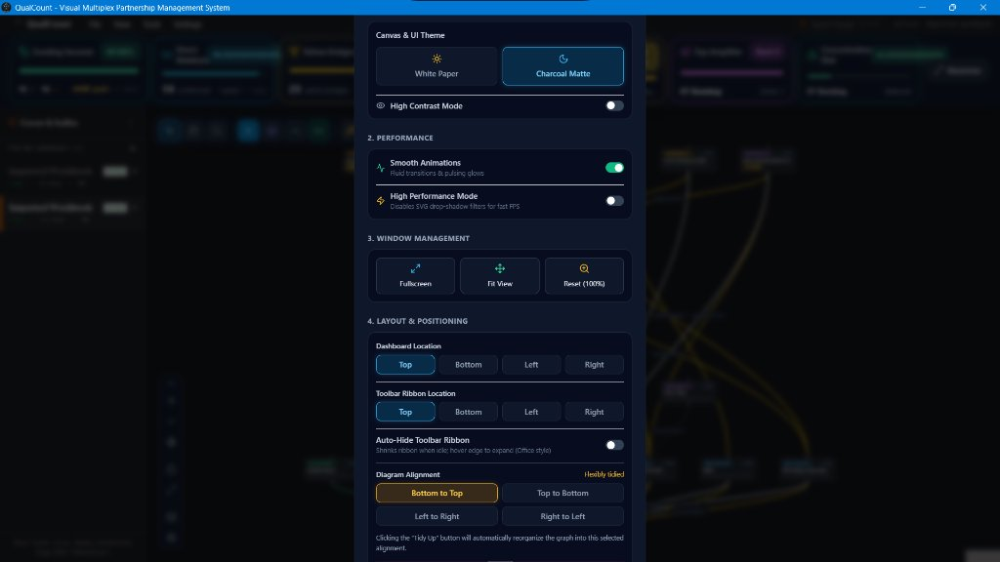

<div align="center">
  
  
  # QualCount
  
  **Visual Multiplex Partnership Navigation & Analytical Accounting System**

  [](#-license)
  [](#-downloads--releases)
  [](https://github.com/Bandetheighteen/QualCount/releases)
  [](https://github.com/xyflow/xyflow)
  [](#%EF%B8%8F-architecture--engineering)
  [](#)
</div>

Social sector leadership and NGO outreach teams often struggle to manage multi-tiered institutional coalitions. Traditional commercial CRMs force non-profits into transactional sales funnels, while spreadsheet trackers fail to capture non-financial institutional bridges, multi-threaded connections, and concentration bottlenecks.

**QualCount** is an offline-first visual partnership management application that models institutional relationships directly as a **bottom-to-top directed multiplex network**. It derives honest, objective quantitative metrics strictly from live graph topology—without subjective 1-to-5 ratings or arbitrary scoring rubrics.

---

## 📥 Downloads & Releases

Pre-compiled standalone desktop binaries for Windows:

| Platform | Package Format | Direct Download | File Size | Description |
|---|---|---|---|---|
| **Windows 10 / 11** | Single-File Installer (`QualCount-Setup.exe`) | [`release/QualCount-Setup.exe`](release/QualCount-Setup.exe) | 4.67 MB | Full NSIS installer with desktop shortcut and uninstaller |
| **Windows 10 / 11** | Standalone Portable Executable (`QualCount.exe`) | [`release/QualCount.exe`](release/QualCount.exe) | 21.72 MB | Portable zero-install executable running anywhere |

> 🚀 **QualCount Version 2.0 (v2.0.0) is officially live!**
> Built on a desktop-ready native WebView2 shell with zero cloud dependencies. Download, launch, and operate your partnership ledger completely offline.

---

## 🏛️ Theoretical & Sociological Foundations

QualCount was created to solve structural failures that occur when social sector practitioners attempt to track complex, multi-stakeholder coalitions using conventional software.

```
┌────────────────────────────────────────────────────────────────────────┐
│                   THE MULTIPLEX PARTNERSHIP PARADIGM                   │
│                                                                        │
│   ▲ TIER 3: Policy, Civic & Government Targets                         │
│   │   [District Administration]   [Municipal Corporation]              │
│   │               ▲                           ▲                        │
│   │       (Yellow Bridges)            (Direct Ties)                    │
│   │               │                           │                        │
│   │ TIER 2: Intermediary Brokers & Institutional Allies                │
│   │   [Academic Research Institute] ───► [Advocacy Coalition]          │
│   │               ▲                                                    │
│   │       (Direct Working Ties)                                        │
│   │               │                                                    │
│   │ TIER 1: Funding & Operational Partners                             │
│   │   [Philanthropic Foundation]  [CSR Grantor]                        │
│   │               ▲                    ▲                               │
│   │       (Green Grant Inflow)  (Green Grant Inflow)                   │
│   │               │                    │                               │
│   │ TIER 0: Root Foundation Anchor (Your NGO)                          │
│   └────────────────────────────────────────────────────────────────────┘
```

### 1. The Sociological Problem: The Breakdown of Spreadsheets

For decades, non-governmental organizations, grassroots consortiums, and civic alliances have relied on flat tabular spreadsheets (such as Microsoft Excel or Google Sheets) to record stakeholder outreach. However, organizational sociology demonstrates that **tabular representations fail fundamentally when applied to multi-organizational alliances**:

- **Destruction of Network Dimensionality:** Spreadsheets flatten multi-layered relationships into isolated rows and columns. A single institutional partner may simultaneously be a funding recipient, a regulatory counterparty, and an intermediary broker. In a 2D grid, this multiplicity is fragmented across disconnected tabs.
- **Invisibility of Transitive Bridge Dependencies:** In social coalitions, access to key decision-makers is almost never direct; it proceeds along paths of referral and social endorsement. Spreadsheets obscure these multi-hop referral chains, rendering practitioners blind to whether access to a critical municipal stakeholder depends on a fragile single link.
- **Hidden Single Points of Failure:** When coalition data is trapped in rows, organizational leaders cannot evaluate *broker concentration*. If 70% of an initiative's civic access paths pass through a single individual or partner organization, the coalition faces catastrophic collapse if that broker departs. Tabular systems cannot compute or visualize this vulnerability.
- **Subjective Scoring Fallacies:** To quantify progress, spreadsheet templates often rely on arbitrary 1-to-5 ratings ("relationship strength: 4/5") or commercial CRM pipeline stages ("prospecting -> negotiation -> closed won"). These metrics are subjective, easily inflated, and divorced from actual network structure.

---

### 2. Ronald Burt's Structural Holes & Granovetter's Weak Ties

QualCount's yellow edge layer and topological metric engine directly embody foundational network sociology:

- **Ronald Burt (1992) & Structural Holes:** Burt established that social capital does not derive solely from dense, insular bonding within a single group, but from bridging *structural holes*—disconnections between distinct institutional clusters. Organizations that span structural holes control information flow, gain early access to novel opportunities, and act as indispensable brokers.
- **Mark Granovetter (1973) & The Strength of Weak Ties:** Granovetter proved that breakthrough opportunities and institutional reach rarely travel through strong, redundant primary ties; they diffuse through *weak ties* that bridge distant social worlds.
- **Operational Implementation in QualCount:**
  - QualCount formalizes non-financial referral pathways as dedicated **Yellow Bridge Edges**.
  - The **Top Amplifier Metric** computes downstream Breadth-First Search (BFS) reach across confirmed yellow ties to pinpoint which partners genuinely expand the coalition's institutional footprint.
  - The **Bridge Concentration Risk Metric** mathematically models structural vulnerability: it calculates the exact percentage of downstream stakeholders who would become completely disconnected if the primary broker severed their relationship.

---

### 3. Elinor Ostrom's Polycentric Governance & Commons Management

The architectural hierarchy of QualCount draws upon Nobel laureate **Elinor Ostrom's (1990) *Governing the Commons***:

- **Nested Enterprises & Polycentricity:** Ostrom showed that durable institutional arrangements are neither rigid top-down state hierarchies nor chaotic uncoordinated markets. Sustainable common-pool governance relies on *nested enterprises*—autonomous local units organized into polycentric tiers of collective choice.
- **Bottom-to-Top Topological Nesting:**
  - Rather than organizing partnerships as top-down sales funnels, QualCount enforces an **inverted Sugiyama hierarchical layout (`direction: UP`)**.
  - The initiating organization anchors the base (**Tier 0: Root NGO**).
  - Funding allocations, working partnerships, and intermediary bridges build upward through intermediate operational tiers (**Tiers 1 & 2**).
  - The summit represents broad systemic targets (**Tier 3: Policy, Community & Government agencies**).
  - This structure honors grassroots agency: initiatives grow outward and upward through voluntary collective alignment rather than coercive command.

---

### 4. Public Choice Theory & Objective Institutional Accounting

To ensure analytical integrity, QualCount eliminates subjective evaluation rubrics in favor of **Public Choice Theory (Buchanan & Tullock 1962)**:

- **Institutional Triangulation over Subjective Surveys:** Rather than asking staff to guess relationship warmth on an arbitrary 1-to-5 scale, QualCount derives institutional reliability strictly from observable network phenomena:
  - *Multi-Thread Target Triangulation:* When three or more distinct, independent partners establish confirmed yellow referral ties toward the same target agency, the target is objectively validated by consensus without relying on self-reported claims.
  - *Owned Conversion Accounting:* Measures how effectively an NGO transforms borrowed social capital (indirect introductions through partners) into durable, direct working relationships (confirmed white ties).
  - *External vs. Decision Costs:* Enables alliance leaders to balance broad coalition consensus against the transaction costs of coordination.

---

## 🖼️ Visual Tour & Interface Guide

Explore the core workflows and interface architecture of QualCount:

### 1. Cover & Ecosystem Overview Macro-Map
The landing view provides an executive summary of all standalone workbooks, showing active initiatives, verified funding percentages, and cross-initiative partner connections.



```
┌────────────────────────────────────────────────────────────────────────┐
│ ◄ Left Drawer: Workbook Registry    │  ▲ Ecosystem Macro-Map:          │
│   • Multi-initiative selector       │    Visualizes inter-workbook     │
│   • Direct file import (.json/csv)  │    cross-pollination & shared    │
│   • New workbook wizard             │    institutional partners        │
└────────────────────────────────────────────────────────────────────────┘
```

---

### 2. Full 2D Canvas & The 7-Metric Analytical HUD
The core workspace features a 2D infinite canvas backed by a high-contrast analytical Heads-Up Display (HUD) computing live topological indicators.



```
┌────────────────────────────────────────────────────────────────────────┐
│ ▲ TOP ANALYTICAL HUD (7 Metric Displays):                              │
│   [💰 Funding: 100%] [🤝 Direct: 93] [⚡ Bridges: 98] [🔄 Conv: 63%]    │
│   [🎯 Triangulated: 28] [📢 Top Amplifier] [⚠️ Bridge Risk: 14%]        │
├────────────────────────────────────────────────────────────────────────┤
│ ◄ Navigation Index Drawer           │  ▼ Floating Action Dock:         │
│   Quick-jump list of all placed     │    [Pointer] [Hand] [Zoom +/-]   │
│   organizations and tier levels     │    [Add Node] [Connect] [Tidy]   │
└────────────────────────────────────────────────────────────────────────┘
```

---

### 3. Root Node Anchor & Multiplex Edge Bundling
QualCount enforces a strict single-root invariant. The initiating organization anchors Tier 0, with multiplex branches color-coded by relationship type:



```
┌────────────────────────────────────────────────────────────────────────┐
│  [Green Branch]  ──► Financial Grant Allocation (ticked/pending)       │
│  [White Branch]  ──► Direct Operational Working Relationship           │
│  [Yellow Branch] ──► Institutional Referral & Introductions            │
│                                                                        │
│  ▲ Lateral Bezier Separation prevents overlapping parallel branches    │
│  ▲ Midpoint pills display funding percentage allocations               │
│  ▲ Branch action buttons allow one-click confirmation (✓) or rejection │
└────────────────────────────────────────────────────────────────────────┘
```

---

### 4. Dense 115+ Node Network in Charcoal Matte
Tested on real-world multi-stakeholder deployments, QualCount handles complex networks of over 100+ organizations with sub-millisecond search, auto-centering beacons, and Illustrator-style subgraph isolation:



```
┌────────────────────────────────────────────────────────────────────────┐
│ ◄ Live Point-of-Contact & Organization Search (Ctrl + F):              │
│   Type any contact name, designation, email, or organization.          │
│   Camera smoothly glides to target with an elevated pulsing beacon.    │
│                                                                        │
│ ◄ Subgraph Isolation Mode (Double Click):                              │
│   Dims all unrelated nodes; marquee drag filters strictly for active   │
│   subgraph members to prevent visual overwhelm in dense clusters.     │
└────────────────────────────────────────────────────────────────────────┘
```

---

### 5. Settings, Alignment & Appearance Modal
Easily toggle between daylight presentation palettes and dark workspace themes, adjust Sugiyama layout spacing, and manage sector taxonomies:



```
┌────────────────────────────────────────────────────────────────────────┐
│ • Universal Themes: "White Paper" (High Contrast) & "Charcoal Matte"   │
│ • Layout Spacing: Layer gap, node separation, and alignment orientation│
│ • Custom Sectors: Add, color-code, and filter organization categories  │
└────────────────────────────────────────────────────────────────────────┘
```

---

## ⌨️ Complete Keyboard Shortcuts & Navigation Reference

QualCount is optimized for rapid, precision interaction with desktop keyboard shortcuts:

| Shortcut | Context | Action |
|---|---|---|
| `Ctrl + F` | Global | Open and focus real-time node & contact search bar |
| `Ctrl + S` | Global | Save active workbook to disk |
| `Ctrl + Shift + S` | Global | Save Workbook As (opens native Windows File Explorer) |
| `Ctrl + B` | Canvas | Toggle Book Index & Table of Contents sidebar drawer |
| `Ctrl + Shift + L` | Canvas | Execute Sugiyama bottom-to-top hierarchical auto-layout |
| `Ctrl + Shift + D` | Canvas | Maximize / minimize detailed analytical metrics ledger |
| `Hold B + Click Node` | Canvas | Multi-select individual nodes collectively |
| `Drag Selected Node` | Canvas | Move all selected nodes simultaneously by the exact same delta |
| `Double Click Node` | Canvas | Enter Adobe Illustrator-style subgraph isolation mode |
| `Double Click Branch`| Canvas | Enter single-branch focus and edit mode |
| `Hold N + Drag Box` | Canvas | Marquee select nodes only (ignores branches) |
| `Hold B + Drag Box` | Canvas | Marquee select branches only (ignores nodes) |
| `Drag Selection Box` | Canvas | Normal marquee selection (in isolation mode: filters highlighted only) |
| `Space + Drag` | Canvas | Pan camera viewport |
| `Escape` | Canvas | Clear active selection, exit isolation mode, or close modals |
| `Delete` / `Backspace` | Canvas | Delete currently selected node(s) or branch(es) |

---

## 🤖 Model Context Protocol (MCP) & Coding Agent Skills

QualCount includes a first-class Model Context Protocol (MCP) server and structured AI Agent skills, enabling autonomous coding agents (Claude Code, Google Antigravity, Cursor, Codex) to programmatically operate, analyze, and mutate the partnership graph.

### 1. Standalone MCP Server (`@qualcount/mcp-server`)
Located in [`packages/mcp-server`](packages/mcp-server), the server exposes standardized JSON-RPC tools:

| MCP Tool | Description |
|---|---|
| `QualCount-list-workbooks` | Lists all available workbooks in the local workspace directory |
| `QualCount-get-workbook` | Retrieves full JSON graph topology (entities, placements, branches, budget) |
| `QualCount-search-entities` | Queries organizations and points of contact across workbooks |
| `QualCount-batch-mutate` | Atomically adds entities, creates placements, and links branches |
| `QualCount-compute-risk-audit` | Computes two-layer structural and qualitative bridge risk metrics |
| `QualCount-parse-spreadsheet` | Parses raw Excel (`.xlsx`) or CSV outreach sheets into workbook graphs |

### 2. Specialized Agent Skills (`.agent/skills/`)
The repository includes production-ready Agent Skills conforming to the standard `SKILL.md` specification:

- **`QualCount-partnership-graph-operator`**: Operational instructions for agents to build, modify, and tidy bottom-to-top multiplex workbooks without violating ownership or hierarchy rules.
- **`QualCount-spreadsheet-to-workflow-mapper`**: Systematic pipeline to convert messy outreach spreadsheets into deduplicated graph structures.
- **`QualCount-two-layer-risk-auditor`**: Guides agents through running quantitative risk audits and publishing structured assessments to the workbook.

#### Configuring MCP in Your Agent
Add the server configuration to your `mcp_config.json`:
```json
{
  "mcpServers": {
    "qualcount-ledger": {
      "command": "node",
      "args": ["packages/mcp-server/dist/index.js"],
      "env": {
        "QUALCOUNT_DATA_DIR": "./data"
      }
    }
  }
}
```

---

## 🛠️ Architecture & Engineering

```
┌────────────────────────────────────────────────────────┐
│               QualCount UI (React 18 / @xyflow)        │
│   • Top Menu Bar (File, View, Tools, Settings)         │
│   • Action Toolbar (Pointer, Pan, Search, Add, Tidy)   │
│   • Interactive 2D Canvas (Custom Nodes & Multiplex)   │
│   • Real-Time Analytical HUD & Search Drawer           │
└───────────────────────────┬────────────────────────────┘
                            │ Zustand Store
                            ▼
┌────────────────────────────────────────────────────────┐
│            Pure TypeScript Engine Core (Zero React)    │
│   • 7-Metric Topological Engine (src/engine/metrics)   │
│   • Sugiyama Inverted Layout (elkjs UP-direction)      │
│   • Parallel Bezier Lateral Separation                 │
│   • AABB Collision & Local Anti-Overlap Engine         │
│   • Subgraph Isolation & Marquee Filter Engine         │
└───────────────────────────┬────────────────────────────┘
                            │ WorkspaceRepository
                            ▼
┌────────────────────────────────────────────────────────┐
│            Persistence & Desktop Shell Layer           │
│   • Native File System Access (FilePicker / JSON)      │
│   • Tauri v2 Windows Shell (WebView2, zero Chromium)   │
│   • Local Single-File Database & Snapshot Backups      │
└────────────────────────────────────────────────────────┘
```

---

## 🚀 Getting Started

### Prerequisites
- Node.js 18+ or 20+
- npm or pnpm
- Rust toolchain (`cargo` / `rustc`) *only required if compiling native Windows desktop binaries from source*

### Development & Verification
```bash
# 1. Install dependencies
npm install

# 2. Run the full automated test suite (22 verification suites)
npm test

# 3. Launch Vite local dev server
npm run dev

# 4. Build web production bundle & compile MCP server
npm run build

# 5. Compile standalone Windows executable bundle (.exe)
npm run build:exe
```

---

## 🤝 Contributing

Contributions and community extensions are welcome:

1. Fork the repository (`git fork https://github.com/Bandetheighteen/QualCount`).
2. Create a feature branch (`git checkout -b feature/new-analytics`).
3. Commit your changes (`git commit -m 'feat: add new analytics view'`).
4. Ensure all 22 test suites pass (`npm test`).
5. Open a Pull Request.

---

## 👨‍💻 Author

QualCount was designed and built by **Shounak Saha** ([@Bandetheighteen](https://github.com/Bandetheighteen)).

> *"Whenever we work on multi-organizational partnership projects—especially in the social sector and among NGOs—it is remarkably difficult to coordinate coalitions using standard spreadsheets. Excel sheets are simply not designed for multiplex institutional networks; they cannot track non-financial introductions, referral paths, or structural dependencies.*
> 
> *Having personally struggled to keep up with cross-organizational partnerships, multi-stakeholder follow-ups, and complex coordination trails across social sector initiatives, I realized that teams need software built specifically for this purpose. That is why QualCount was created. Because it was made for non-profit organizations, social sector workers, and grassroots coalitions, QualCount is completely free and open-source."*

- **GitHub:** [@Bandetheighteen](https://github.com/Bandetheighteen)
- **Portfolio & Connect:** [linktr.ee/shounaksaha2000b](https://linktr.ee/shounaksaha2000b)

---

## 📄 License

QualCount is open-source software dual-licensed under either:

- **MIT License** ([LICENSE-MIT](LICENSE-MIT) or [opensource.org/licenses/MIT](https://opensource.org/licenses/MIT))
- **Apache License, Version 2.0** ([LICENSE-APACHE](LICENSE-APACHE) or [apache.org/licenses/LICENSE-2.0](https://www.apache.org/licenses/LICENSE-2.0))

at your option. See [LICENSE](LICENSE) for details.
